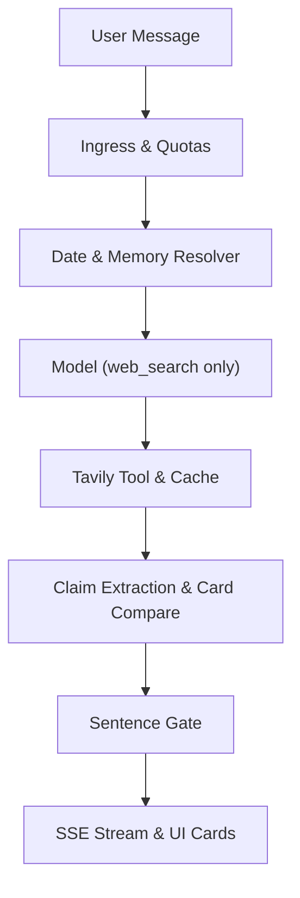

# Proofline: design

In Proofline, application code owns dates, recall, evidence and status. The language model decides when to search and writes commentary on checked findings.

## How it works

When a message arrives, I inspect session cookies and enforce rate limits of 20 requests per session and 200 requests per day. My date resolver maps phrases like "last Tuesday" to calendar dates in the user's timezone. SQLite with BM25 retrieves past turns before model invocation. The model receives one external tool: `web_search`. When searches return pages, deterministic code extracts quotes, checks candidate domains against a known registry, and compares new prices against historical baselines on matching domains. While commentary streams, a sentence gate holds numbers until supported by extracted quotes.

## Why it is built this way

I gave the model exactly one tool to prevent multi-tool decision loops and hallucinated arguments. Calendar arithmetic happens in code because language models frequently slip days around month boundaries. I enforce verbatim string containment against stored page text so that no model can invent quotes. For status assignment, absence of search results yields "Couldn't confirm", never "Same as before". Progressive sentence gating streams text immediately while holding numeric sentences until verified. I chose native `node:sqlite` in WAL mode to eliminate external runtime dependencies while maintaining concurrency.

## Considered and rejected

I rejected vector databases because SQLite with BM25 provided exact date filtering and zero npm dependencies. I rejected exposing memory search as a model tool because pre-retrieving context in code guarantees that history is always available before the first token. I rejected multi-agent pipelines because coordinating multiple model roles increased latency and token cost without improving accuracy. I rejected cross-domain price comparisons because comparing third-party aggregators against vendor pages caused false change reports; all comparisons stay restricted to identical parent domains.

## With another week

I would add a headless browser fallback for JavaScript-rendered pricing tables that return empty static markup. I would expand the verified domain registry with automated certificate transparency logs. I would also add structured parsing for complex multi-seat tiered pricing matrices. The offline demo is scripted so it runs without keys; it is not evidence of live behaviour.

## Measured

On 2026-11-14 with build id 31ef6a0fbdf1 on Node 22:
- 258 tests pass in the offline fixture-based suite (`latest.json`).
- Live run (`live-latest.json`, n=3 official prompts, free tier): first token median 21.5 s, total latency median 26.9 s, citation faithfulness 17/17 quotes, 0 false unchanged statuses.
- Cold container boot from idle and third-party scraping blocks are not measured in CI.
