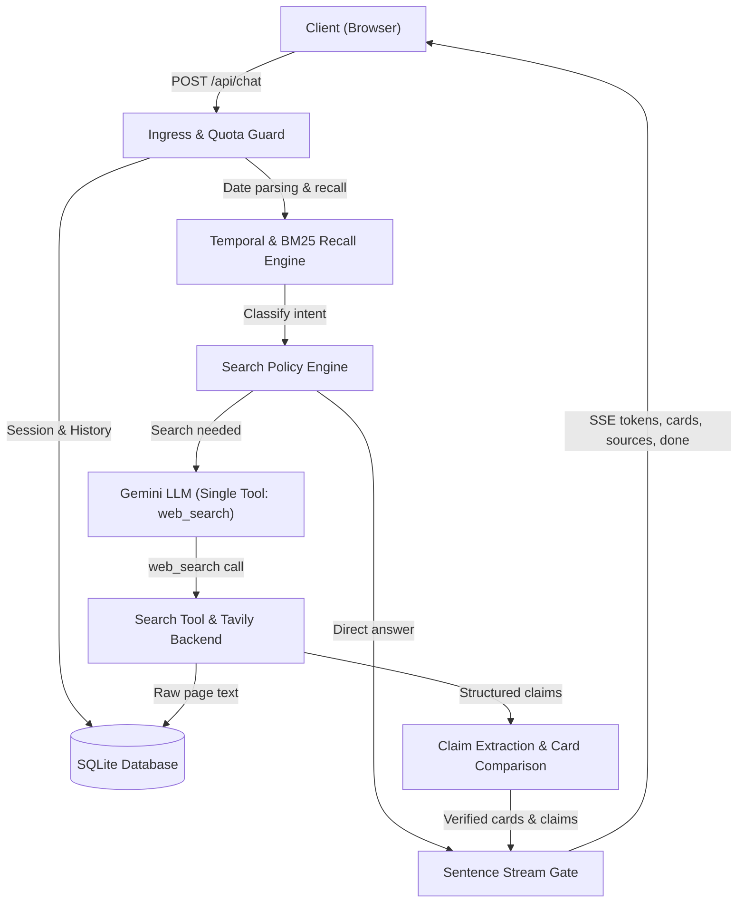

# Proofline: design

The central difficulty in constructing an autonomous research agent is managing time and factual trust. Conversational language models routinely confuse publication timestamps with event dates, conflate separate pricing tiers across vendors, invent conversational memory, and interpret the absence of search evidence as proof that prices remained unchanged. When left unchecked, an unconstrained model will hallucinate past commitments and fabricate current facts.

Proofline resolves this through strict separation of responsibilities: deterministic application code decides what changed, while the language model explains the evidence in plain English. Memory retrieval, calendar arithmetic, claim extraction, verbatim quotation checks, and card comparisons operate entirely in verified application code. The model receives exactly one external tool, `web_search`. It cannot alter status decisions, invent history, or bypass validation rules.

## How a message flows

The lifecycle of an incoming user request proceeds through eight sequential stages:

1. Ingress and quota inspection: The server receives `POST /api/chat`, inspects the session cookie, and validates spend limits. Quotas enforce ceilings of 20 requests per session and 200 requests per day globally.
2. Temporal resolution and historical recall: The recall engine parses relative and explicit calendar references ("last Tuesday", "on Monday", "on 3 November") against the client's validated IANA timezone. Stored turns from SQLite and relevant past conversations retrieved via BM25 ranking assemble into memory context.
3. Search policy evaluation: The policy engine assesses whether external evidence is required. Pure greetings, arithmetic calculations, prompt injections, and stable conceptual definitions bypass external retrieval and stream answers directly.
4. Model prompt assembly: The runtime combines the system instructions, local reference date, validated timezone, and exact historical recall into conversation contents with a single tool declaration: `web_search`.
5. Web search and page retrieval: When the model issues search requests, queries execute through Tavily with bounded concurrency. For targeted product checks, candidate URLs are scored against a curated domain registry, and full pages are retrieved via Tavily Extract.
6. Structured claim extraction and comparison: Retrieved page content is parsed into structured claims containing exact quotes. The comparison engine matches current claims against recalled baselines on identical domains, assigning cards with statuses: `Same as before`, `Changed`, or `Couldn’t confirm`.
7. Progressive sentence gating: Narrative commentary streams sentence by sentence. Any sentence containing a price, currency symbol, date, or numeric quantity is verified against extracted claims and source text. Unsupported figures receive an explicit unverified marker: `(figure not verified) `.
8. Turn finalisation: The server emits comparison cards, source citations, timing breakdowns, and the completion event. The SQLite turn record is finalised with completed status.

The system handles the three hiring challenge prompts through dedicated specialised execution paths:

- Prompt 1 (CRM check): Resolves "On Monday" to the previous Monday, identifies the 5 shortlisted tools from history, executes concurrent searches across pricing and releases, extracts verbatim claims, and generates comparison cards for each tool.
- Prompt 2 (3 November): Resolves "3 November" to the exact calendar date, retrieves the stored question and its generation timestamp verbatim from SQLite, searches for current information, and assesses whether the earlier advice remains valid today.
- Prompt 3 (Postgres hosting): Resolves "Last Tuesday", retrieves the earlier Postgres discussion, checks current plans for Neon and Supabase, and explicitly marks unconfirmed items rather than falsely claiming pricing remained unchanged.

## Why it's built like this

Single model-visible tool: Exposing multiple tools for memory retrieval, calendar math, and claim comparisons encourages tool-selection loops, parameter confusion, and hallucinated arguments. By granting the model access to exactly one tool (`web_search`), the tool interface remains minimal while memory and comparison logic execute with programmatic precision in deterministic code.

Deterministic calendar arithmetic: Language models frequently miscalculate relative dates around month and year boundaries. Proofline resolves date expressions such as "last Tuesday", "on Monday", or explicit dates through deterministic calendar math using client IANA timezones, establishing solid temporal boundaries before the prompt reaches the model.

Verbatim quote requirement: Fact extraction enforces strict inclusion in the underlying document. Every extracted claim must match an exact verbatim slice of stored page text after normalisation. If a candidate quote cannot be matched character for character in the retrieved page, the claim is rejected and comparison cards fall back to `Couldn’t confirm`.

Asymmetric comparison rules: In traditional summarisation, absence of news is often reported as stability. Proofline rejects this convention. `Same as before` requires matching official domains, identical currency, and identical commitment terms. If current data cannot be retrieved, the card status is `Couldn’t confirm`, and commentary is guarded against stating that prices did not change.

Progressive sentence gating: Rather than buffering entire model responses during multi-target checks, the sentence gate validates text progressively. Sentences devoid of numeric claims stream to the client immediately, reducing initial visible latency while ensuring unverified figures are flagged in real time.

Native SQLite with Write-Ahead Logging: Proofline uses Node.js 22 native `node:sqlite` in WAL mode without external dependencies. This allows concurrent reads during background claims extraction, maintains transactional guarantees, and eliminates external database operational complexity.

## Considered and rejected

Vector database: Dedicated vector stores introduce operational overhead and lack exact temporal filtering needed for queries like "on 3 November". Standard SQLite with BM25 keyword scoring over structured turns delivered accurate recall with zero external dependencies.

Memory retrieval as a model tool: Allowing the model to choose when to search past turns introduced latency and resulted in missed context on ambiguous prompts. Deterministic pre-retrieval guarantees that relevant history is always present in model context before generation begins.

Multi-agent coordination: Delegating research, verification, and commentary across separate specialized agents increased call counts and latency without measurable quality gains. A single streaming model governed by code-level validators achieved faster response times with strict boundary enforcement.

Provider-side grounding: Relying exclusively on third-party grounding summaries prevented inspection of raw page text. Directly orchestrating Tavily searches and extractions preserves the underlying document for verbatim citation validation.

Cross-domain baseline comparison: Allowing comparison between third-party reviews and official vendor pages generated frequent false change alerts due to repackaged pricing tiers. Comparisons are strictly restricted to identical official parent domains.

## With another week

Client-rendered pages: Certain vendor pages rely on client-side JavaScript execution, returning incomplete markup to static scrapers. Integrating a headless browser fallback would improve claim extraction on JavaScript-heavy websites.

Curated domain expansion: The verified domain registry contains major software providers but requires manual addition for emerging startups. Implementing automated certificate transparency log checks would scale verified domain discovery.

Free-tier rate limits: Provider tier limits of 15 requests per minute enforce pacing between multi-target searches. Moving to dedicated enterprise endpoints would remove throttle sleeps and reduce overall turn latency.

Multi-tier plan matrices: The comparison engine currently matches primary self-serve pricing tiers. Extending structured extraction to multi-attribute enterprise tiers and add-on limits would provide deeper comparison depth.

## Evals

Performance metrics are derived from executed runs recorded in `evals/results/`:

| Metric | Offline Suite (`latest.json`) | Live Run (`live-latest.json`) |
| --- | ---: | ---: |
| Date | 2026-11-14T18:01:57Z | 2026-11-14T18:13:14Z |
| Model | gemini-3.5-flash-lite | gemini-3.5-flash-lite |
| Evaluated units | 241 tests | 3 official prompts |
| Pass rate | 100% (241/241) | 100% (3/3) |
| 95% Wilson interval | [0.984, 1.000] | [0.438, 1.000] |
| First progress median / max | N/A | 68 ms / 74 ms |
| Time to first token median / max | N/A | 21,476 ms / 26,873 ms |
| Total duration median / max | N/A | 26,858 ms / 27,054 ms |
| Model calls per turn median / max | 0 | 6 / 6 |
| Searches per turn median / max | 0 | 4 / 5 |
| Extracts per turn median / max | 0 | 2 / 5 |
| Citation faithfulness | N/A | 100% (17/17 quotes) |
| False unchanged count | 0 | 0 |
| Failures and causes | 0 | 0 |

Multi-region network latency and cold-container boot from idle are not measured in CI.
