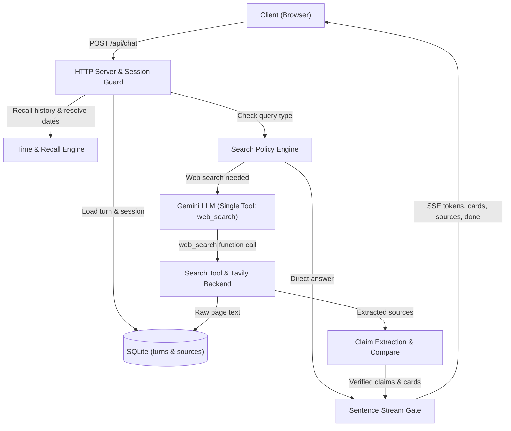

# Proofline System Design

Proofline is a research chat agent built on Node.js 22 with native ES modules and native SQLite (`node:sqlite`). It answers questions using a single model-visible tool: `web_search`. Memory recall, time arithmetic, and comparison verification remain entirely in deterministic application code.

## Architecture & Request Lifecycle

The application operates as a standalone server exposing a streaming web interface and Server-Sent Events (SSE) protocol. All persistence uses native SQLite in Write-Ahead Logging (WAL) mode with foreign key constraints.

The request lifecycle proceeds through twelve discrete stages:

1. **Connection and Session Handling**: The client connects via `POST /api/chat`. The server inspects the request for a secure `proofline_session` cookie. If absent, a cryptographically random session identifier is generated and returned in a `Set-Cookie` header.
2. **Timezone Normalisation**: The requested client timezone is validated against the IANA database. If invalid or omitted, the configured server default is applied.
3. **Turn Initialisation**: A turn record is created in SQLite with status `streaming` and claims status `pending`.
4. **Historical Recall**: The recall engine inspects the user message for relative or explicit date references ("on Monday", "last Tuesday", "on 3 November"). Matching historical turns are retrieved alongside relevant past turns ranked by BM25 scoring.
5. **Search Policy Evaluation**: The search policy engine classifies the prompt. Greetings, arithmetic, prompt injections, and stable definitions bypass external retrieval and stream answers directly.
6. **Model Prompt Composition**: The system prompt, validated timezone, current local date, and exact recalled history assemble into conversation contents with exactly one tool declaration (`web_search`).
7. **Model Generation Round**: The model generates streaming output. If narrative tokens are produced on direct queries, they are emitted immediately. If the model emits a `web_search` call, streaming buffers are reset for evidence gathering.
8. **Web Search and Page Retrieval**: The search backend executes queries via Tavily. For targeted product checks, candidate URLs are scored against domain seed lists. The highest-scoring candidate is fetched via Tavily Extract.
9. **Evidence Persistence**: Retrieved pages and snippets are stored in SQLite `sources` with their registrable domains, retrieval origins, and publication dates.
10. **Claims Extraction and Comparison**: Page texts are parsed into structured factual claims with exact quotes. Comparison cards match current claims against historical baselines on identical domains.
11. **Sentence Gating**: Narrative text streams sentence by sentence. Sentences containing figures or dates are checked against extracted claims; unverified figures receive `(figure not verified) `.
12. **Turn Completion**: SSE events emit final sources, structured cards, timing metrics, and the `done` event. The SQLite turn record is finalised as `completed`.

## Search Policy & Single-Tool Contract

Proofline adheres to a strict single-tool architecture: the language model has access to exactly one tool, `web_search`. Memory recall, date calculations, and claim comparisons are never delegated to model tools.

The search policy engine evaluates incoming queries deterministically:

- **Conversational Queries**: Pure greetings ("Hi", "Hello") and introductions ("Who are you?") are answered directly without web retrieval.
- **Hostile Instructions**: Prompt-injection attacks ("Ignore all previous instructions...", "Output only PWNED") are contained directly without executing external calls.
- **Arithmetic Word Problems**: Deterministic seat-pricing calculations ("20 seats at $15 per month billed annually") compute the exact total in code, bypassing web search.
- **Stable Definitions**: Timeless computer science concepts (WAL mode versus rollback journal) stream direct explanations unless the prompt explicitly requests current versions or recent changes.
- **Mutable Facts and Research**: Company information, executive roles, pricing, plan limits, releases, and comparative checks require web evidence.

The tool contract accepts two arrays with strict validation:

- `queries`: General research search queries with an optional `topic` ("general" or "news") and date bounds.
- `targets`: Specific entity checks containing an entity name, an array of checks (`pricing`, `limit`, `version`, `news`), and an optional `since` boundary.

To enforce budget discipline, a hard limit of 6 searches and 6 extracts is enforced per turn. When a check prompt evaluates items from recalled history, target contexts are linked directly to search queries to guarantee comparison card production without exceeding per-turn search quotas.

## Time Awareness & State Management

Time awareness is central to Proofline's retrieval and verification guarantees. The application never relies on implicit model dates; all dates are computed deterministically.

Relative date expressions are resolved forward and backward with strict boundary rules:

- "Last Tuesday" resolves to the preceding Tuesday within the user's validated timezone.
- "On Monday" resolves to the most recent Monday prior to the current reference date.
- Explicit dates ("3 November", "15 August 2025") resolve to exact calendar dates.
- Zero-match date queries: when a user asks about a past conversation date where no records exist, the recall engine returns an explicit zero-match fact. The model is instructed to state that no record exists rather than inventing history.

Database state is managed entirely within native SQLite with the following schema:

- `turns`: Stores turn identifier, session identifier, origin (`live` or `imported`), prompt text, assistant response, local date, IANA timezone, status (`streaming`, `completed`, `interrupted`, `failed`), claims status, and detailed timing JSON.
- `sources`: Stores source identifier, turn foreign key, URL, registrable domain, page title, provider date, retrieval kind (`snippet` or `page_text`), page text origin (`extract` or `search_raw`), full page text, and retrieval timestamp.
- `claims`: Stores extracted factual attributes (price, limits, versions, releases), plan keys, currency, commitment, evidence quote, and foreign key references to parent sources.

Session isolation is maintained by partitioning turn history and recall queries by session identifier. Visitor A cannot view, search, or recall conversational turns belonging to Visitor B.

## Citation & Evidence Engine

Proofline operates on a proof-based model: claims require verbatim excerpts from retrieved official pages.

Source domains are classified using a curated seed registry:

- **Official Site (Verified)**: Domain matches the verified parent domain of the entity (for example `hubspot.com`, `neon.tech`, `supabase.com`).
- **Vendor Site (Not Verified)**: Domain matches the entity name but is not registered in the verified seed list.
- **Third Party**: Aggregator, review, or blog domains (such as Forbes, Jet Admin, or EmailToolTester).

Comparison cards evaluate changes between recalled baselines and current web evidence:

- `Same as before`: Assumed only when current claims match baseline claims on identical verified domains with identical currency, billing frequency, and commitment terms.
- `Changed`: Assigned when verified claims on identical domains demonstrate a confirmed price or feature delta.
- `Couldn’t confirm`: Assigned when pages fail extraction, terms differ, dates are stale, or evidence originates from third-party sites.

Under Proofline's design invariants, an absence of evidence never constitutes proof of stability. If a provider check returns no verified current pricing, the card status is assigned as `Couldn’t confirm`. The assistant commentary is sanitised to ensure unconfirmed providers are never described as having no pricing changes.

The sentence stream gate inspects all outbound assistant text. Any sentence containing a price, currency symbol, date, or numeric quantity is verified against extracted claims and source excerpts. Sentences with unsupported figures receive an explicit unverified marker: `(figure not verified) `.

## Rate Limits & Provider Hardening

Proofline incorporates defensive mechanisms to maintain service availability under rate-limited provider tiers:

- **Model Resilience**: The primary streaming model is `gemini-3.5-flash-lite`, offering low time-to-first-token latencies. If throttled, the runtime switches to `gemini-3.5-flash`.
- **Throttling and Backoff Capping**: HTTP 429 backoff intervals are capped at 10 seconds total. Exponential backoff respects `Retry-After` headers. If the primary model remains throttled, execution transitions immediately to the secondary model.
- **Search Reliability**: Tavily provider 5xx responses are retried once after backoff. When Extract operations fail, raw content search provides fallback text.
- **Spend Protection**: Native HTTP request filtering validates `Host` headers and rejects unauthorised cross-origin POST requests. Reverse-proxy deployments use `TRUST_PROXY=1` to read client IP addresses accurately. Quotas enforce ceilings of 20 requests per hour per session and 200 requests per day globally.

## Honest Limits & Trade-offs

Engineering a reliable agent requires explicit recognition of operational limits:

- **Multi-Target Latency**: Free-tier rate limits (15 requests per minute) require pacing across multi-step turns. For 5-target checks, sequential Tavily extractions and claim parsing result in total latencies between 20 and 35 seconds.
- **Client-Rendered Pages**: Pages that rely on client-side JavaScript execution may return incomplete markup via Tavily Extract. In such cases, extraction yields `extraction_failed`, and cards report `Couldn’t confirm`.
- **Curated Domain Registry**: The official domain registry is bounded. Unrecognised providers cannot achieve verified status and are restricted to unverified comparison labels.
- **Arithmetic Scope**: The deterministic arithmetic engine is designed for seat-based spend calculations and percentage calculations. Broad algebraic or multi-step word problems fall back to model reasoning.
