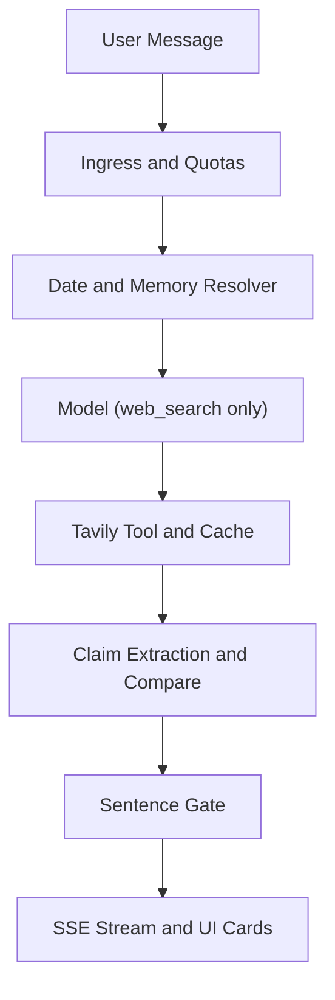

# Proofline: design

In Proofline, application code owns dates, recall, evidence extraction, and comparison verdicts. The language model decides when to search and writes natural commentary explaining checked findings.

## How it works

The lifecycle resolves dates and memory deterministically before invoking model tools:

1. Ingress validates cookies and enforces budgets of 20 requests per session and 200 requests per day.
2. The date resolver converts relative phrases to calendar dates in the user timezone.
3. SQLite FTS5 retrieves relevant prior turns before model invocation.
4. The model receives one external tool: `web_search`.
5. Web searches execute through Tavily, recording URL, domain, snippet, and page text.
6. Code extracts structured claims and verifies quotes against stored page text.
7. The comparison engine evaluates prices against baselines on matching domains.
8. While commentary streams, a sentence gate holds numeric statements until verified.

Prompt handling:
- Prompt 1: Maps Monday to a calendar date, searches candidate CRMs, and compares retrieved tiers against stored baselines.
- Prompt 2: Locates the 3 November turn, reproduces advice, and checks provider pages for changes.
- Prompt 3: Establishes the baseline date for Postgres providers, executes fresh checks, and compares plans on identical domains.

Comparison cards represent code-evaluated per-entity verdicts, and sources represent unique web pages retrieved during the turn.

## Why it is built this way

I gave the model exactly one tool to prevent multi-tool routing loops. When multiple tools are exposed, models oscillate between memory search and web queries; keeping memory in code keeps interaction focused on fresh evidence retrieval.

Calendar arithmetic happens in deterministic code to establish explicit calendar bounds in the user timezone. Resolving dates before model invocation ensures consistent week and month boundaries regardless of sampling variance.

I enforce verbatim string containment against stored page text to verify quote provenance. Every numerical claim and plan attribute must match actual text extracted from the retrieved document before a status is assigned.

For status assignment, lack of fresh search results produces "Couldn't confirm", never "Same as before". An unchanged status requires positive evidence from an authoritative domain matching the historical baseline.

Progressive sentence gating streams introductory text immediately while holding numeric sentences until verified. I chose native `node:sqlite` in WAL mode to eliminate external runtime dependencies while maintaining concurrency.

## Considered and rejected

- Vector databases: rejected for SQLite FTS5 with BM25 to retain exact calendar filtering and zero npm dependencies.
- Memory as a model tool: rejected for pre-retrieving context in code to preserve the single-tool constraint.
- Multi-agent architecture: rejected for a single coordinator loop to keep execution traces inspectable and avoid latency.
- Cross-domain comparisons: rejected because comparing across distinct domains conflates third-party summaries with vendor plans.
- Provider-side grounding: rejected for application-controlled search to ensure quote containment and independent comparisons.

## With another week

- Headless browser rendering for client-side JavaScript pricing tables that return empty static markup.
- Automated certificate transparency lookups to expand the verified brand registry.
- Structured parsing for multi-tier volume matrices with dynamic slider tiers.
- Cross-session persistence across sleeping free-tier containers.
- The offline demo is scripted so it runs without keys; it is not evidence of live behaviour.

## Measured

<!-- measured:start -->
On 2026-11-15 with build id 07c2367d0f73 on Node 24:
- 258 tests pass in the offline fixture-based suite (`latest.json`).
- 3 benchmark queries evaluated on the free tier.
- Time to first token: median 29.3 s, max 33.4 s.
- Total latency: median 29.6 s, max 34.3 s.
- Model calls per turn: median 5. Searches per turn: median 4.
- Citation faithfulness: 7/7 quotes.
- Cold container boot from idle and third-party scraping blocks are not measured in CI.
<!-- measured:end -->
